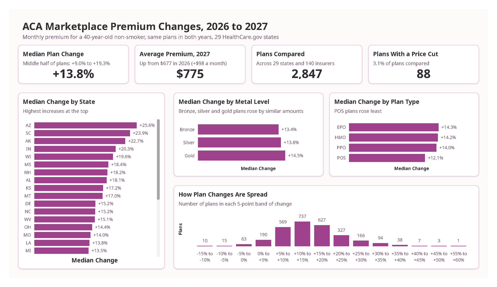
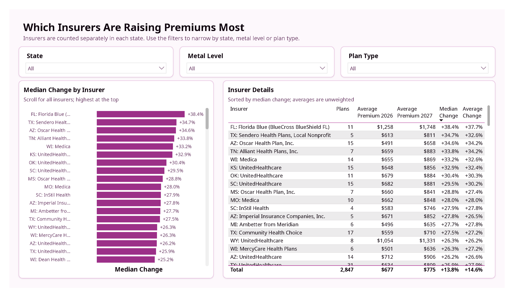
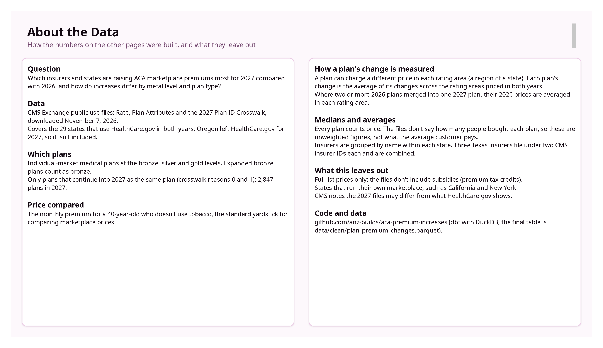
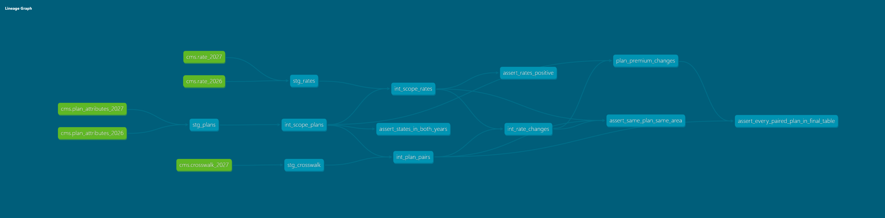

# ACA Marketplace Premium Changes, 2026 to 2027

**[Live dashboard (Power BI)](https://app.powerbi.com/view?r=eyJrIjoiZGY5ODVmYmMtYmVhYi00MGMzLWJkMWUtZjBhZTdjODQwMmMwIiwidCI6IjVhMmZlNzJiLTQ4YWEtNGZlZi1hZTg3LTMzM2EzNGQ3ZjUwZCJ9)** · **[dbt docs and lineage graph](https://aca-premium-increases.netlify.app)**

Reviewing how much more the same ACA marketplace plans cost in 2027, and where, across the 29 states that use HealthCare.gov. Built with [CMS.gov](https://www.cms.gov/) public data, dbt and Power BI.







## Context

2027 is going to be the second year since the enhanced premium tax credits expired at the end of 2025. In their rate filings, insurance companies cite rising costs of care, a sicker remaining risk pool as enrollment falls, and federal rule changes. [KFF](https://www.kff.org/about-us/) estimates that risk pool changes added about 4 points to premiums in 2026, with a similar additional effect expected in 2027 ([KFF](https://www.kff.org/affordable-care-act/9-things-to-watch-for-the-2027-aca-open-enrollment-period/)). For HealthCare.gov states, HHS also lowered the user fee built into premiums from 2.5% to 1.9% for 2027 ([Health Affairs](https://www.healthaffairs.org/content/forefront/hhs-finalizes-sweeping-marketplace-changes-part-5-exchange-requirements-agents-and)).

This project measures where prices for continuing plans rose. The data can't say why, although outside checks from rate filings are tagged **Filing check** in this document and may provide useful context.

## Findings

- **The same plans cost a median 13.8% more in 2027:** Half rose between 9.0% and 19.3%; the average age-40 premium went from $677 to $775 a month.
	- *Filing check:* KFF reports benchmark silver premiums up 11% in HealthCare.gov states, a narrower measure than this one ([KFF](https://www.kff.org/affordable-care-act/9-things-to-watch-for-the-2027-aca-open-enrollment-period/)).
- **Location matters far more than metal level or plan type:** State medians run from +4.6% (Arkansas) to +25.6% (Arizona), a 21-point spread. Metal levels differ by about 1 point (bronze +13.4%, silver +13.8%, gold +14.5%); POS plans rose least (+12.1%).
- **UnitedHealthcare rose more than the typical plan in 18 of its 19 states:** showing a median of +23.8% across 258 plans.
	- *Filing check:* its own filings requested 34.81% in Kansas ([filing](https://ratereview.healthcare.gov/files-cjn/949687101_ks_94968_uhic_both_ind_partII_v01_070726.pdf)) and 30.46% in Oklahoma ([ACA Signups](https://acasignups.net/rate_changes/2027/ok)), close to the +33.0% and +30.4% medians here.
- **Florida Blue's continuing plans show the biggest jumps:** 100 of the 103 single-area increases over 50% belong to Florida Blue's two companies. The main company's 11 continuing plans have a median of +38.4%, against a Florida median of +10.6%.
	- *Filing check:* Florida's regulator reports enrollment-weighted averages of +18.8% for Blue Cross and Blue Shield of Florida and +9.5% for its Health Options HMO, and +10.4% statewide ([FLOIR](https://floir.gov/docs-sf/life-health-libraries/federal-health-insurance/2027-plan-year/aca-2027-web-tables_deliverable-part-1.pdf?Status=Master)). The +38.4% covers only plans that continue unchanged, not the company's whole book.
- **88 plans (3.1%) got cheaper:** mostly from Blue Cross and Blue Shield of Oklahoma (24), Blue Cross and Blue Shield of Texas (17) and AvMed in Florida (10).
	-  *Filing check:* BCBS of Oklahoma filed an average of −2.37% for its MyBlue HMO plans and +14.39% for its PPO plans ([BCBSOK](https://www.bcbsok.com/individual-family-health-insurance/rate-review)). BCBS of Texas and AvMed filed average increases ([BCBSTX](https://www.bcbstx.com/individual-family-health-insurance/rate-review), [FLOIR](https://floir.gov/docs-sf/life-health-libraries/federal-health-insurance/2027-plan-year/aca-2027-web-tables_deliverable-part-1.pdf?Status=Master)), so their cuts are specific plans.
- **Recommendation/Next Steps:** 
	- Start a 2027 rate review with UnitedHealthcare's filings and Florida Blue's continuing plans. Both sit well above their states' medians, beyond what a market-wide factor would explain. 
	- Individuals renewing plans in high-increase states or with these insurers have the most reason to compare plans before auto-renewing.

## Question

In the second year after the enhanced premium tax credits expired, where are the same plans' premiums rising most, and how does that differ by insurer, metal level and plan type?

## Data

- **Source:** [CMS Exchange public use files](https://www.cms.gov/marketplace/resources/data/public-use-files) (Rate and Plan Attributes for 2026 and 2027; 2027 Plan ID Crosswalk), downloaded November 7, 2026.
- **Coverage:** the 29 states on HealthCare.gov in both years (Oregon left for 2027).
- **Price:** the monthly premium for a 40-year-old non-smoker, the yardstick [KFF](https://kff.org/f332bd2) uses.
- **Categories:** metal level (bronze, silver, gold) and plan type (HMO, PPO, EPO, POS).
- **Final table:** `data/clean/plan_premium_changes.parquet`, which the dashboard reads from GitHub. 
- **Grain: one row per 2027 plan that continues one or more 2026 plans** (key `plan_id_2027`, 2,847 rows), with state, insurer, metal level, plan type, predecessor plans, rating areas compared, average 2026 and 2027 premiums, and the change in dollars and percent.


## Cleaning Log

Printed by `scripts/cleaning_log.py`, which stops with an error if any step doesn't add up.

**Plans**

| Step | 2026 rows | Removed | 2027 rows | Removed |
|---|---:|---:|---:|---:|
| Plan variants in the raw file | 22,059 | | 20,062 | |
| Unique plans (variants combined) | 5,144 | 16,915 | 4,741 | 15,321 |
| Individual market | 4,815 | 329 | 4,502 | 239 |
| Medical, not dental-only | 4,044 | 771 | 3,717 | 785 |
| Bronze, silver or gold | 3,925 | 119 | 3,562 | 155 |
| States in both years (removes Oregon) | 3,866 | 59 | 3,562 | 0 |

**Prices**

| Step                       | 2026 rows |   Removed | 2027 rows |   Removed |
| -------------------------- | --------: | --------: | --------: | --------: |
| Price rows in the raw file | 2,235,761 |           | 2,115,809 |           |
| Age-40 prices              |    43,832 | 2,191,929 |    41,480 | 2,074,329 |
| Prices for plans in scope  |    22,868 |    20,964 |    22,009 |    19,471 |

**Comparison**

| Step | Rows |
|---|---:|
| 2026 plans in scope | 3,866 |
| 2026 plans with a same-plan match in 2027 (crosswalk reason 0 or 1) | 2,818 |
| Matched pairs (a split plan has one pair per 2027 plan) | 2,878 |
| Price changes (one per pair per rating area priced in both years) | 15,352 |
| Final table: 2027 plans (merged plans combined) | 2,847 |

## Decisions

| Decision                                                            | Why                                                                                  |
| ------------------------------------------------------------------- | ------------------------------------------------------------------------------------ |
| Age-40, non-tobacco premium                                         | The standard comparison price; every plan in scope has one.                          |
| Same plan only (crosswalk reasons 0 and 1)                          | Other reasons move customers to a different plan, so the change isn't like for like. |
| Average each plan's change across rating areas priced in both years | Each plan counts once.                                                               |
| Average merged 2026 plans' prices in each rating area               | Each 2027 plan counts once (21 merges).                                              |
| Expanded bronze counts as bronze                                    | They're bronze-level plans; most 2027 bronze plans carry the label.                  |
| Median as the headline                                              | Not pulled up by a few very large increases.                                         |
| Insurers grouped by name within each state (140)                    | Three Texas insurers file under two CMS IDs each.                                    |
| dbt with DuckDB; Power BI reads the Parquet file from GitHub        | Runs on a laptop with no account, server or gateway.                                 |

## Plans That Didn't Continue

Of the 3,866 in-scope 2026 plans, 1,048 have no same-plan match in 2027, and every one moved its customers to another plan: 
- 425 to a different plan in the same product (reason 2)
- 169 to a different product (7 with reason 3, 162 with reason 6) 
- 454 to a different insurer chosen by CMS (reason 8)

Each plan is counted under its lowest reason across counties.
**Total:** 425 + 7 + 162 + 454 = 1,048; with the 2,818 matched plans, that's all 3,866.

## Data Gaps

- **Unweighted:** no enrollment counts, so figures describe what insurers charge, not what the average customer pays. 
	- *Florida Blue shows how far the two can differ.*
- **Causes:** the files can't separate policy effects from medical cost growth.
- **List prices only:** no subsidies (premium tax credits).
- **One age:** age 40, non-tobacco.
- **Continuing plans only:** customers moved to a different plan aren't measured.
- **HealthCare.gov states only:** state-run marketplaces aren't in the files.
- **Preliminary:** CMS notes the 2027 files may differ from HealthCare.gov.

## How to Run

Needs Python 3.13. Commands are for Windows PowerShell.

```powershell
git clone https://github.com/anz-builds/aca-premium-increases.git
cd aca-premium-increases
py -3.13 -m venv .venv
.venv\Scripts\pip install -r requirements.txt
```

1. Download the five CMS zip files from the [public use files page](https://www.cms.gov/marketplace/resources/data/public-use-files) and unzip them into `data\raw\2026\` and `data\raw\2027\`. On macOS or Linux, the download step in `.github/workflows/ci.yml` does this.
2. Run `.venv\Scripts\dbt build`: 8 models and 30 checks, including business-rule checks that every pair comes from crosswalk reason 0 or 1, every change compares the same plan in the same rating area, and every matched 2027 plan reaches the final table.
3. Run `.venv\Scripts\python scripts\cleaning_log.py`.

GitHub Actions runs all of this on every push to `default`.

The core comparison, from `models/intermediate/int_rate_changes.sql`: only rating areas priced in both years survive the second join.

```sql
select
    pairs.pair_key || '|' || r26.rating_area as pair_area_key,
    pairs.pair_key, pairs.plan_id_2026, pairs.plan_id_2027, pairs.state,
    pairs.issuer_id, pairs.issuer_name, pairs.metal_level, pairs.plan_type,
    r26.rating_area,
    r26.rate_age_40 as rate_2026,
    r27.rate_age_40 as rate_2027,
    r27.rate_age_40 - r26.rate_age_40 as change_dollars,
    -- Stored as a fraction: 0.05 means a 5% increase
    (r27.rate_age_40 - r26.rate_age_40) / r26.rate_age_40 as change_pct
from pairs
-- Inner join: the 2026 plan's price in each rating area it was sold in.
join rates as r26 on r26.plan_key = pairs.plan_key_2026
-- Inner join: the 2027 plan's price in the same rating area...
join rates as r27 on r27.plan_key = pairs.plan_key_2027
   and r27.rating_area = r26.rating_area
```
